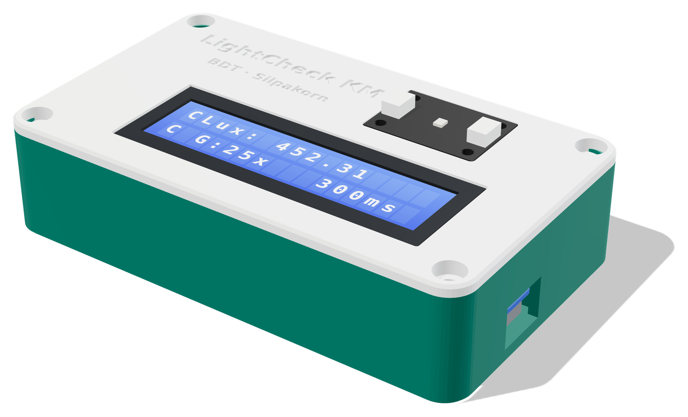
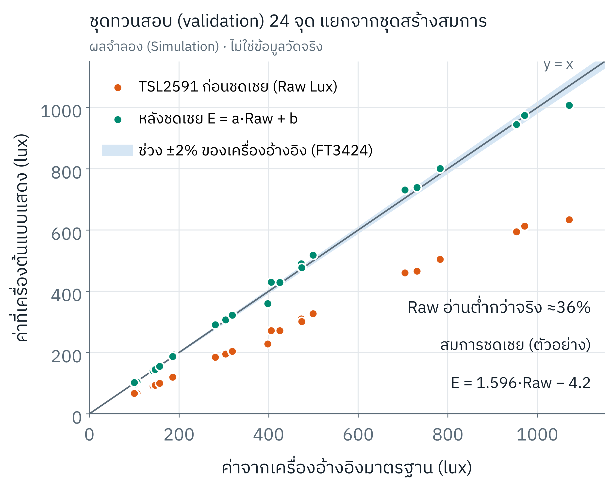
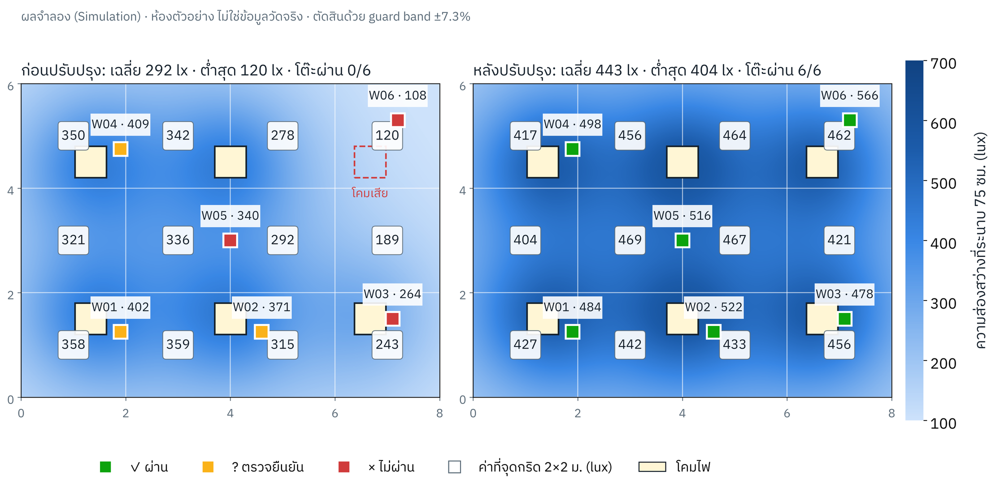

# LightCheck KM

**จากเครื่องวัดแสงต้นทุนต่ำ สู่ระบบความรู้เพื่อยกระดับสภาพแวดล้อมสำนักงานสีเขียว**
*From a low-cost light meter to an organisational knowledge system for Green Office*

ว่าที่ ร.ต. ดร. บรรพต ดลวิทยากุล · ฝ่ายบริหารและพัฒนาดิจิทัลเทคโนโลยี
สำนักดิจิทัลเทคโนโลยี (Bureau of Digital Technology) มหาวิทยาลัยศิลปากร
ผลงาน Oral Presentation · **Silpakorn KM Day 2569** (18 ธันวาคม 2569) · ด้านการบริหารจัดการและสร้างนวัตกรรม



> **บทบาทของเครื่อง**: เป็นเครื่องมือ **ตรวจคัดกรอง (pre-survey)** หาจุดเสี่ยงจำนวนมากด้วยต้นทุนต่ำ
> ผลที่จะใช้เป็นหลักฐาน Green Office ข้อ 5.2.1 ต้องยืนยันด้วย lux meter ที่ได้มาตรฐานและมีใบสอบเทียบ
> และห้ามใช้แอปบนโทรศัพท์มือถือเป็นหลักฐาน [1]

## ทำไมต้องมี

สายตาของคนทำงานปรับตัวกับแสงสลัวได้จน **"รู้สึกว่าพอ" ทั้งที่แสงอาจไม่พอสำหรับการทำงานทั้งวัน** แสงที่ไม่พอสะสมเป็นความล้าตา ปวดศีรษะ และความผิดพลาดในงาน จึงต้องวัดเป็นตัวเลข เกณฑ์ที่ใช้คือ พื้นที่สำนักงานต้องมีค่าเฉลี่ย ≥ 300 lux
และจุดต่ำสุด ≥ 150 lux ส่วนงานประจำ ณ จุดทำงานใช้ 400–500 lux [2] เครื่องมาตรฐานที่ถูกที่สุดที่สำรวจได้ (HIOKI FT3424) ราคา 28,184 บาทรวม VAT
หน่วยงานจึงมีได้ไม่กี่เครื่อง ขณะที่ต้องวัดทุกห้องอย่างน้อยปีละครั้ง [1][3]

LightCheck KM ใช้ **TSL2591 + Wemos D1 mini + LCD1602** ต้นทุนจริงราว **385 บาท** (MCU 89 + sensor 200 + LCD 70 + กล่อง PLA+ ≈ 26 บาท; ถูกกว่าเครื่องมาตรฐานที่ถูกที่สุดที่สำรวจได้ HIOKI FT3424 ราคา 28,184 บาทรวม VAT ราว 73 เท่า) ทำ pre-survey ได้หลายจุดพร้อมกัน
แล้วส่งเฉพาะจุดเสี่ยงไปยืนยันด้วยเครื่องมาตรฐาน หัวใจของผลงานคือการเปลี่ยนข้อมูลหน้างานให้เป็น
**ความรู้ขององค์กร** ที่ตรวจสอบย้อนกลับได้และใช้ซ้ำได้

```
P วางแผน (เกณฑ์ + ผังจุดวัด) → D ตรวจวัด (pre-survey) → C ตรวจสอบ (guard band + ยืนยันด้วยเครื่องมาตรฐาน)
→ A ปรับปรุง + ตรวจซ้ำ → KM ถอดบทเรียน → KM ใช้ซ้ำ (public repository) → รอบถัดไป
```

## เริ่มต้นใน 5 ขั้น

1. ซื้ออุปกรณ์ตาม [hardware/bom.md](hardware/bom.md) และพิมพ์กล่องจาก [hardware/enclosure/stl/](hardware/enclosure/stl/)
2. ต่อวงจรตาม [docs/wiring.md](docs/wiring.md)
3. อัปโหลด [firmware v1.1.0](firmware/LightCheck_TSL2591_Calibrated/LightCheck_TSL2591_Calibrated.ino) ตาม [docs/user-manual.md](docs/user-manual.md)
4. สอบเทียบกับเครื่องอ้างอิงตาม [calibration/README.md](calibration/README.md)
5. ลงพื้นที่ตาม [docs/measurement-SOP.md](docs/measurement-SOP.md) ใช้ [grid_planner.py](tools/survey/grid_planner.py) สร้างจุดวัดและแบบบันทึก


## โครงสร้าง repository

| ตำแหน่ง | องค์ความรู้ที่จัดเก็บ |
|---|---|
| `firmware/` | Source code: I2C self-check, auto-range (hysteresis), Raw/Corrected log, compensation, traceability |
| `hardware/enclosure/` | กล่องพิมพ์ 3 มิติ: STL พร้อมพิมพ์ + generator แบบ parametric + renders + วิธีพิมพ์/ประกอบ |
| `hardware/bom.md` | รายการอุปกรณ์และต้นทุน เทียบเครื่องมาตรฐาน |
| `calibration/` | เครื่องมือสร้างและทวนสอบสมการชดเชย, แบบจำลอง Monte Carlo, ค่าประมาณ bias จาก datasheet |
| `docs/` | คู่มือ, SOP + guard band, ผังวงจร, troubleshooting, KM process, Green Office 5.2.1, อ้างอิง |
| `tools/survey/` | วางจุดกริด 2 × 2 ม. + สร้างแบบบันทึก, digital twin ห้องสำนักงาน |
| `tools/fw_sim/` | ทดสอบ logic ของ firmware บนคอมพิวเตอร์ (ไม่ต้องมีฮาร์ดแวร์) |
| `tools/diagrams/` | ตัวสร้างผังวงจร (รวมแหล่งจ่ายไฟ USB-C), ภาพอุปกรณ์, flow firmware แบบ SVG |
| `poster/` | โปสเตอร์ KM Day 2569: PDF, **ไฟล์ต้นฉบับ PowerPoint 80 × 100 ซม. ที่แก้ไขได้**, ตัวแปลง CMYK |
| `templates/` | แบบบันทึกผลมาตรฐานของหน่วยงาน |
| `evidence/` | ภาพการตรวจวัด Before/After (ปิดบังข้อมูลส่วนบุคคล) |
| `lessons-learned.md`, `CHANGELOG.md` | บทเรียนและวิวัฒนาการขององค์ความรู้ |

## ผลการใช้งานจริง

นำไปคัดกรองห้องทำงานของสำนักดิจิทัลเทคโนโลยี พบว่า **ห้องทำงานเกือบทุกห้อง ยกเว้นห้องประชุม มีแสงต่ำกว่าระดับมาตรฐาน 10–30 %**
ผู้บริหารสำนักดิจิทัลเทคโนโลยีวางแผนปรับปรุงทันที (PDCA: Act)

- ขาดเล็กน้อย → เปลี่ยนหลอด LED ให้วัตต์สูงขึ้น: **P<sub>ใหม่</sub> = P<sub>เดิม</sub> × E<sub>เป้าหมาย</sub> / E<sub>วัดได้</sub>**
- ขาดมาก → ติดหลอดเพิ่ม: **N<sub>ใหม่</sub> = ⌈N<sub>เดิม</sub> × E<sub>เป้าหมาย</sub> / E<sub>วัดได้</sub>⌉**

ที่มาของสูตร ตัวอย่าง และเครื่องคำนวณ: [docs/lighting-improvement.md](docs/lighting-improvement.md) · [tools/survey/lighting_upgrade.py](tools/survey/lighting_upgrade.py)

## ผลการประเมินเชิงอัลกอริทึม (ผลจำลอง · ยังไม่ใช่ข้อมูลวัดจริง)

ยังไม่มีข้อมูลวัดคู่กับเครื่องอ้างอิง ความแม่นยำที่คาดว่าได้รับจึงประเมินด้วยแบบจำลอง Monte Carlo 5,000 รอบ
จากสเปก datasheet ของ TSL2591 สูตรของไลบรารี Adafruit และสเปกเครื่องอ้างอิง Hioki FT3424 (±2 % rdg.)
โดยใช้โค้ดชุดเดียวกับที่จะใช้กับข้อมูลจริง

| ตัวชี้วัด (ชุดทวนสอบแยกจากชุดสร้างสมการ) | ก่อนชดเชย | หลังชดเชย |
|---|---|---|
| MAPE (มัธยฐาน) | 37 % | **2.5 %** |
| ความคลาดเคลื่อนเทียบค่าจริงที่ระดับ 95 % | – | **±7.3 %** |
| ตัดสินผ่าน/ไม่ผ่านผิดที่เกณฑ์ 300 lux | 44.9 % | 2.2 % → **0.07 %** เมื่อใช้ guard band |



Digital twin ของห้องตัวอย่าง 8 × 6 ม. แสดงวงจร ตรวจ → พบ → แก้ → ตรวจซ้ำ ด้วยฟิสิกส์ของแสง (ไม่ใช่ห้องจริง)



สร้างตัวเลขและรูปทั้งหมดใหม่ได้ด้วย `make all` (Python 3 + numpy + matplotlib, g++ สำหรับ `fw_sim`)

## Firmware v1.1.0: สิ่งที่แก้

พบว่า auto-range ของ v1.0 แกว่งระหว่าง gain จน LCD ขึ้น `SATURATED` เป็นช่วง ๆ (ตรวจพบด้วย `tools/fw_sim`)
v1.1 คาดการณ์ค่าหลังเปลี่ยน gain และมี hysteresis ทำให้ช่วงแสงสำนักงาน ~100–2,900 lux อ่านที่ gain 25x เสมอ
ใช้สมการชดเชยชุดเดียวได้ทั้งช่วง

**ปัญหาที่พบหน้างาน**: แสง LED ไม่เหมือนแสงธรรมชาติ (สเปกตรัม/IR ต่างกัน) และกระพริบ 100 Hz ตามไฟกระแสสลับ 50 Hz
ค่าแต่ละครั้งจึงไม่นิ่ง v1.1 ใช้ integration 300 ms (= 30 รอบการกระพริบพอดี) + ค่าเฉลี่ย 5 รอบ และแสดง `*` เมื่อค่านิ่ง
ดู [CHANGELOG.md](CHANGELOG.md) และ [lessons-learned.md](lessons-learned.md)

## การถ่ายทอดและเผยแพร่

Repository นี้เปิดสาธารณะเพื่อให้บุคลากรทุกส่วนงานของมหาวิทยาลัยนำไปสร้าง ใช้ และต่อยอดได้เอง
มี **Light Survey Package** สำหรับส่วนงานที่ต้องการสำรวจแสงเอง และใช้ Issues เป็นช่องถาม-ตอบ
ดู [docs/km-dissemination.md](docs/km-dissemination.md)

## ข้อจำกัด

- ไม่ระบุ accuracy ±X % ของ TSL2591 เพราะ datasheet ไม่มี end-to-end lux accuracy ความแม่นยำที่รายงานต้องมาจากการทวนสอบกับเครื่องอ้างอิงจริง
- สมการชดเชยใช้ได้กับเซนเซอร์ กล่อง และตำแหน่งหัวรับแสงที่ใช้สอบเทียบเท่านั้น
- ขนาดบางส่วนของกล่อง (LCD bezel, D1 mini) เป็นค่าทั่วไป ต้องวัดโมดูลจริงก่อนพิมพ์ (ดู `[VERIFY]` ใน generator)

## อ้างอิง

ดู [docs/references.md](docs/references.md) — [1] Green Office 2569 · [2] มาตรฐานความเข้มของแสงสว่าง 2561 ·
[3] หลักเกณฑ์การตรวจวัด 2561 · [4][5] Adafruit / ams TSL2591 · [6] Lorenzo et al., *Sensors* 2022 · [7] HIOKI FT3424

## License

Code: MIT · Docs, figures and hardware files: CC BY 4.0 · ดู [LICENSE](LICENSE)

---

### English summary

LightCheck KM is a ~฿385 office illuminance **pre-survey** instrument (TSL2591 + ESP8266 + LCD1602) and the
knowledge system around it: firmware with auditable raw/corrected logging, a parametric 3D-printed enclosure,
an SOP with a guard-band decision rule, calibration tooling and Thai documentation. Official Green Office
evidence is always confirmed with a calibrated, standards-compliant lux meter. All accuracy figures in this
repository are **simulated** (Monte Carlo from datasheet specifications) until real paired measurements exist.
