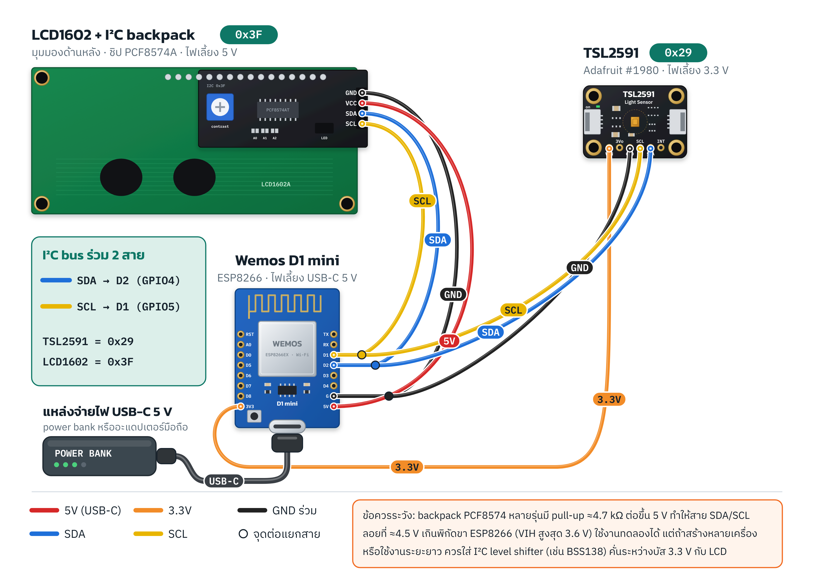
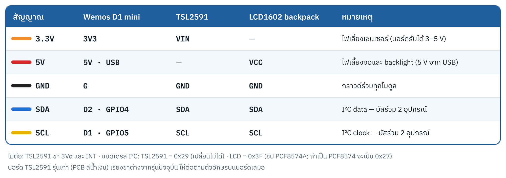
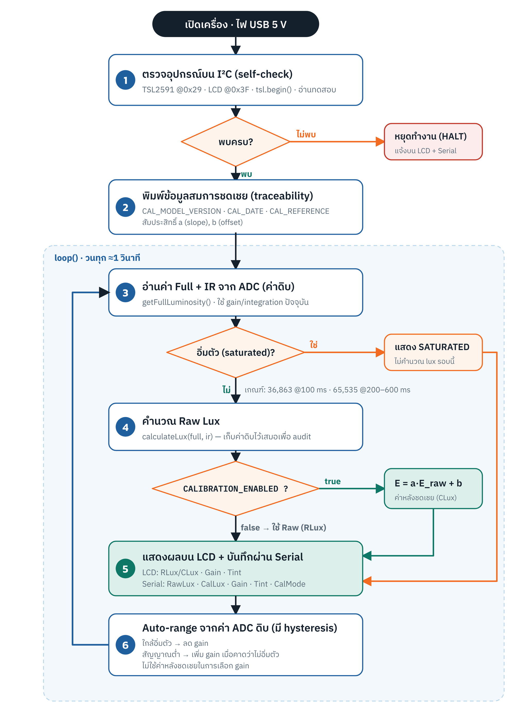
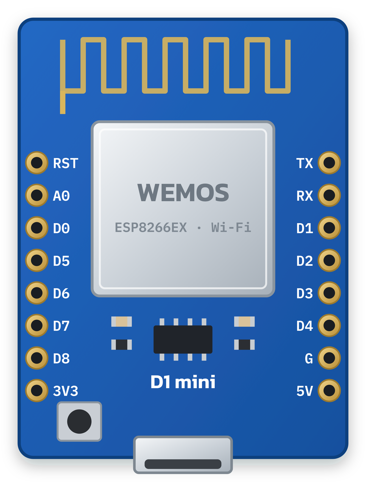
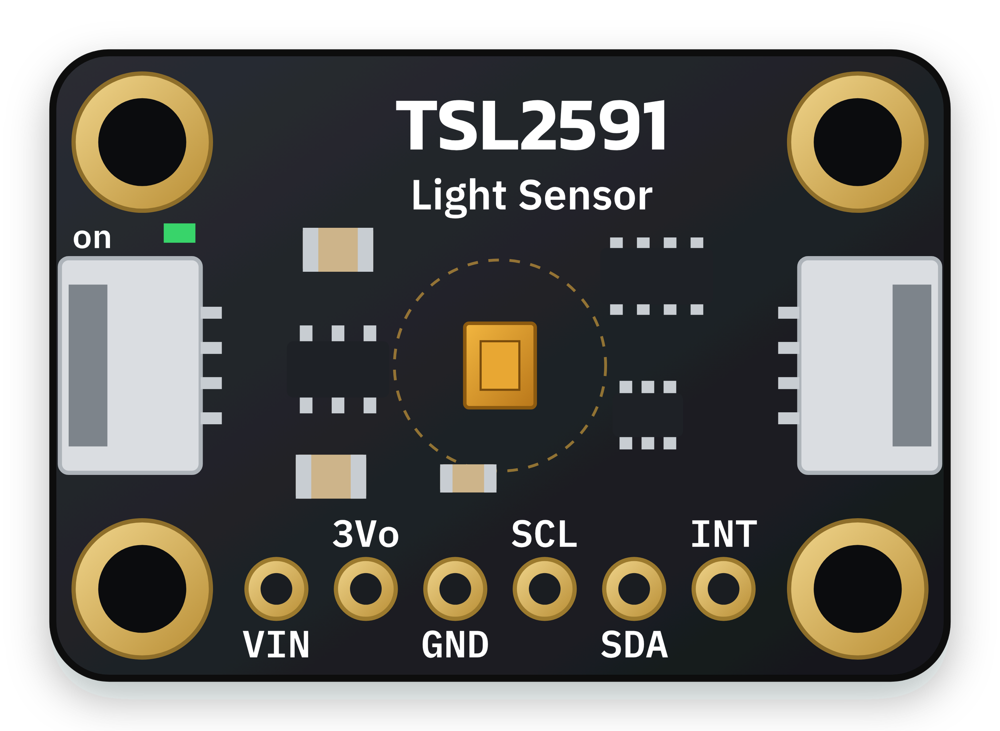
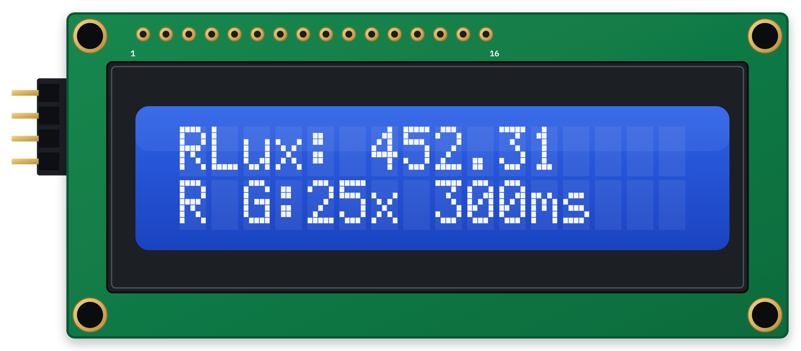
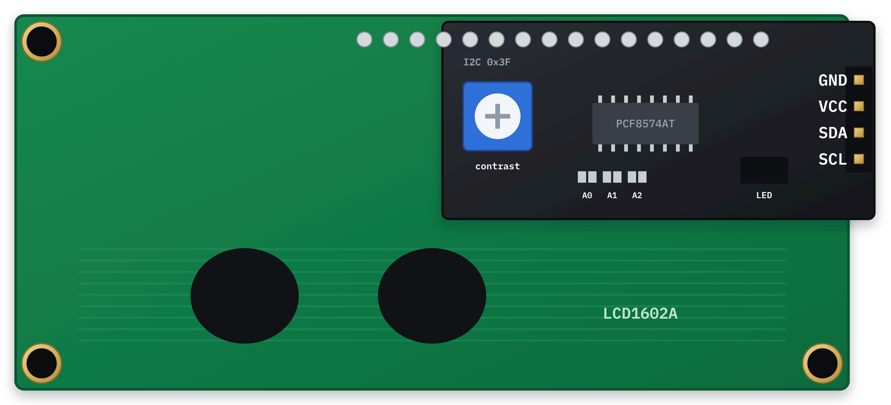

# ผังการต่อวงจร LightCheck KM

เครื่องต้นแบบใช้ **บัส I²C ร่วมกัน 2 สาย** (SDA, SCL) ระหว่าง Wemos D1 mini กับอุปกรณ์ 2 ตัว คือเซนเซอร์แสง TSL2591 และจอ LCD1602 ที่มี I²C backpack (PCF8574A) จึงใช้สายน้อยและประกอบซ้ำได้ง่าย ผังนี้ตรงกับค่าในเฟิร์มแวร์ `firmware/LightCheck_TSL2591_Calibrated/LightCheck_TSL2591_Calibrated.ino` (`Wire.begin(D2, D1)`, `TSL2591_ADDR 0x29`, จอ LCD หาแอดเดรสอัตโนมัติ 0x27/0x3F ตั้งแต่ v1.1.1)

**แหล่งจ่ายไฟ:** เสียบสาย USB-C 5 V จาก power bank หรืออะแดปเตอร์มือถือเข้าที่พอร์ต USB ของ D1 mini
บอร์ดจะจ่าย 5 V ให้จอ LCD และแปลงเป็น 3.3 V ให้เซนเซอร์เอง จึงไม่ต้องมีแบตเตอรี่หรือวงจรไฟเลี้ยงเพิ่ม
(บอร์ดรุ่นพอร์ต micro-USB ใช้สาย micro-USB แทนได้ ผังสายเหมือนเดิม) power bank บางรุ่นตัดไฟเองเมื่อใช้กระแสน้อย
ถ้าเครื่องดับเองระหว่างวัด ให้เปิดโหมดกระแสต่ำ (low-current mode) ของ power bank หรือใช้อะแดปเตอร์แทน

## ตารางการต่อสาย

| สัญญาณ | สีสาย (แนะนำ) | Wemos D1 mini | TSL2591 | LCD1602 backpack | หมายเหตุ |
|---|---|---|---|---|---|
| 3.3 V | ส้ม | `3V3` | `VIN` | — | ไฟเลี้ยงเซนเซอร์ (บอร์ด Adafruit รับได้ 3–5 V) |
| 5 V | แดง | `5V` (ไฟจาก USB-C / power bank) | — | `VCC` | ไฟเลี้ยงจอและ backlight |
| GND | ดำ | `G` | `GND` | `GND` | กราวด์ร่วมทุกโมดูล |
| SDA | น้ำเงิน | `D2` (GPIO4) | `SDA` | `SDA` | I²C data ใช้ร่วมกัน 2 อุปกรณ์ |
| SCL | เหลือง | `D1` (GPIO5) | `SCL` | `SCL` | I²C clock ใช้ร่วมกัน 2 อุปกรณ์ |

ขาที่ไม่ต้องต่อ: TSL2591 `3Vo` (ไฟ 3.3 V ขาออกจากบอร์ด) และ `INT` (ไลบรารีไม่ได้ใช้)

## ขั้นตอนการต่อ

1. ถอดสาย USB ออกก่อนต่อสายทุกครั้ง
2. ต่อ **GND ร่วม** ก่อน: D1 mini `G` ไปที่ TSL2591 `GND` และ backpack `GND`
3. ต่อไฟเลี้ยง: D1 mini `3V3` ไปที่ TSL2591 `VIN` และ D1 mini `5V` ไปที่ backpack `VCC`
4. ต่อบัส I²C: `D2` ไปที่ `SDA` ของทั้งสองอุปกรณ์ และ `D1` ไปที่ `SCL` ของทั้งสองอุปกรณ์ (ใช้จุดต่อแยกสายหรือบัดกรีรวมที่ขา D1 mini)
5. เสียบ USB แล้วดู Serial Monitor (115200 baud) เฟิร์มแวร์จะตรวจอุปกรณ์เองตอนเปิดเครื่อง ถ้าพบ `TSL2591 NOT FOUND @ 0x29` ให้ตรวจสาย SDA/SCL/ไฟเลี้ยงของเซนเซอร์
6. ถ้าจอสว่างแต่ไม่มีตัวอักษร ให้หมุน trimpot `contrast` สีน้ำเงินบน backpack

## ข้อมูลขา (ตรวจสอบจากแหล่งต้นทาง)

- **Wemos D1 mini** (มองด้านบน เสาอากาศอยู่บน USB อยู่ล่าง) แถวซ้ายจากบนลงล่าง: `RST A0 D0 D5 D6 D7 D8 3V3` แถวขวา: `TX RX D1 D2 D3 D4 G 5V` บอร์ดขนาด 34.2 × 25.6 มม. ขา IO ทำงานที่ 3.3 V
- **Adafruit TSL2591 #1980** รุ่นปัจจุบัน (PCB สีดำ มีช่อง STEMMA QT) ขนาด 25.4 × 17.8 มม. รูยึด Ø2.5 มม. 4 มุม (ระยะ 20.32 × 12.7 มม.) เรียงขาจากซ้าย: `VIN 3Vo GND SCL SDA INT` แอดเดรส 0x29 เปลี่ยนไม่ได้
  - **รุ่นเก่า (PCB สีน้ำเงิน)** เรียงขาเป็น `Vin GND 3vo Int SDA SCL` ซึ่งต่างจากรุ่นปัจจุบัน ให้ต่อตามตัวอักษรบนบอร์ดเสมอ
  - ใช้สาย STEMMA QT / Qwiic (JST-SH 4 ขา) แทนการบัดกรีหัวเข็มได้ สีมาตรฐานของสายคือ ดำ = GND, แดง = V+, น้ำเงิน = SDA, เหลือง = SCL ซึ่งตรงกับสีที่ใช้ในผังนี้
- **LCD1602 + I²C backpack** ขั้วต่อ 4 ขาเรียง `GND VCC SDA SCL` อยู่ด้านเดียวกับขา 1 ของจอ (ด้านซ้ายเมื่อมองจากด้านหน้า หรือด้านขวาเมื่อมองจากด้านหลัง)
  - ชิป **PCF8574A(T)** แอดเดรส 0x38–0x3F (ค่าเริ่มต้น **0x3F** ตามเฟิร์มแวร์) ส่วนชิป **PCF8574(T)** แอดเดรส 0x20–0x27 (ค่าเริ่มต้น **0x27**) firmware v1.1.1 หาแอดเดรสเองและพิมพ์ผล `I2C scan:` บน Serial ตอนเปิดเครื่อง ถ้าต้องการบังคับแอดเดรสให้แก้ `LCD_ADDR_FIXED`

## ข้อควรระวัง: ระดับแรงดันบนบัส I²C

backpack PCF8574 หลายรุ่นมีตัวต้านทาน pull-up ประมาณ 4.7 kΩ ต่อสาย SDA/SCL ขึ้นไปที่ `VCC` เมื่อจ่ายไฟ backpack 5 V สาย I²C จะถูกดึงขึ้นไปที่ราว 4.5 V (คิดจาก 4.7 kΩ → 5 V ขนานกับ pull-up 10 kΩ → 3.3 V บนบอร์ด TSL2591) ซึ่งเกินค่า VIH สูงสุด 3.6 V ของขา ESP8266 ตาม datasheet

- วงจรแบบนี้เป็นวิธีที่นิยมและมักใช้งานได้ในเครื่องทดลอง แต่ถือว่าทำงานนอกพิกัด
- ถ้าจะสร้างหลายเครื่องหรือใช้งานระยะยาว แนะนำให้ใส่ **I²C level shifter แบบ 2 ทิศทาง (เช่นโมดูล BSS138 4 ช่อง)** คั่นระหว่างบัส 3.3 V ของ D1 mini/TSL2591 กับฝั่ง 5 V ของ backpack
- ไม่แนะนำให้ถอด pull-up บน backpack ออกเฉยๆ ขณะที่ยังจ่ายไฟจอ 5 V เพราะ PCF8574 ต้องการ VIH ≥ 0.7 × VCC (≈ 3.5 V) สัญญาณ 3.3 V อาจไม่พอ
- อีกทางเลือกคือใช้จอ LCD1602 รุ่น 3.3 V แล้วจ่าย `VCC` จาก `3V3` แทน

## ลำดับการทำงานของเฟิร์มแวร์

1. สแกนบัส I²C หา TSL2591 ที่ 0x29 และ LCD (0x27 หรือ 0x3F อัตโนมัติ) แล้วอ่านค่าทดสอบ ถ้าไม่พบให้หยุดทำงานและแจ้งบนจอ/Serial
2. พิมพ์ข้อมูลสมการชดเชย (`CAL_MODEL_VERSION`, `CAL_DATE`, `CAL_REFERENCE`, a, b) เพื่อการตรวจสอบย้อนกลับ
3. ในแต่ละรอบ อ่านค่า Full และ IR จาก ADC
4. ตรวจการอิ่มตัวตาม datasheet (36,863 counts ที่ 100 ms, 65,535 counts ที่ 200–600 ms) ถ้าอิ่มตัวจะแสดง `SATURATED`
5. คำนวณ Raw Lux ด้วย `calculateLux()` แล้วชดเชยด้วย `E = a·E_raw + b` เฉพาะเมื่อ `CALIBRATION_ENABLED = true`
6. แสดงผลบน LCD และส่ง RawLux/CalLux/Gain/Tint ออก Serial
7. ปรับ gain อัตโนมัติจากค่า ADC ดิบ (ไม่ใช้ค่าหลังชดเชย) แล้ววนรอบถัดไป

## ภาพอุปกรณ์

| Wemos D1 mini | TSL2591 |
|---|---|
|  |  |

| LCD1602 ด้านหน้า | LCD1602 ด้านหลัง (I²C backpack) |
|---|---|
|  |  |

ภาพทั้งหมดเป็นภาพเวกเตอร์วาดใหม่ (ไฟล์ `.svg` อยู่ในโฟลเดอร์ `img/`) เพื่อแสดงตำแหน่งขาและหน้าที่ ไม่ได้แสดงรายละเอียดอุปกรณ์ทุกชิ้นบนบอร์ด

## แหล่งอ้างอิง

- Adafruit TSL2591 Breakout PCB (EagleCAD ขนาดบอร์ด ตำแหน่งขาและรูยึด): <https://github.com/adafruit/Adafruit-TSL2591-Breakout-PCB>
- Adafruit TSL2591 Pinouts: <https://learn.adafruit.com/adafruit-tsl2591/pinouts>
- WEMOS D1 mini (ขนาดบอร์ด, IO 3.3 V): <https://www.wemos.cc/en/latest/d1/d1_mini.html>
- Wokwi LCD1602 element (ตำแหน่งขั้วต่อ I²C ของ backpack): <https://github.com/wokwi/wokwi-elements/blob/main/src/lcd1602-element.ts>
- NXP PCF8574/PCF8574A datasheet (ช่วงแอดเดรสและ VIH) และ Espressif ESP8266EX datasheet (VIH สูงสุด 3.6 V)
