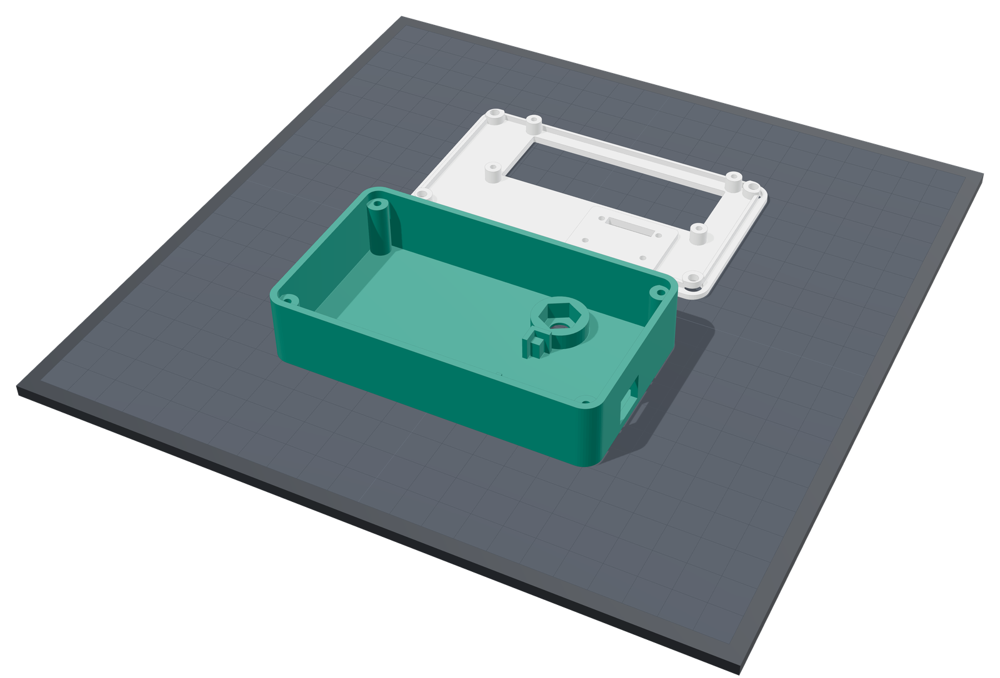
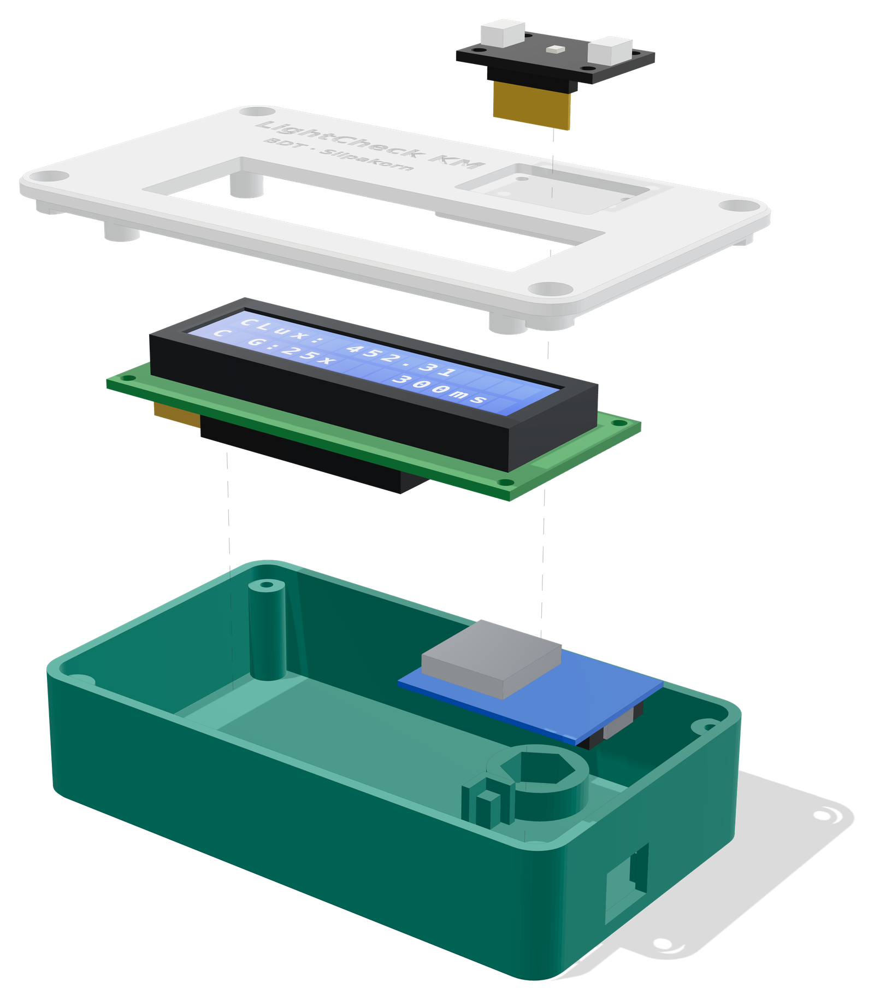

# กล่องเครื่องวัดแสง LightCheck KM (ไฟล์พิมพ์ 3 มิติ)


กล่องสองชิ้น (ฐาน + ฝา) สำหรับ TSL2591 + Wemos D1 mini + LCD1602 I2C
ขนาดภายนอก **108 × 63 × 26 มม.** ใช้ถือวัดหรือตั้งบนขาตั้งกล้องที่ระดับระนาบวัด 75 ซม. ก็ได้

| ไฟล์ | รายละเอียด |
|---|---|
| `stl/lightcheck_base.stl` | ฐาน (วางพื้นกล่องลงฐานพิมพ์ จัดทิศไว้แล้ว) |
| `stl/lightcheck_lid.stl` | ฝา (คว่ำหน้าบนลงฐานพิมพ์ จัดทิศไว้แล้ว) |
| `src/lightcheck_enclosure.py` | สคริปต์สร้างแบบแบบ parametric (manifold3d) แก้ค่าแล้วรันใหม่ได้ |
| `stl/proxies/*.stl`, `stl/scene.json` | ชิ้นจำลองโมดูล ใช้ตรวจการชนและเรนเดอร์ภาพเท่านั้น (ไม่ต้องพิมพ์) |
| `render/` | ตัวเรนเดอร์ภาพ (three.js + Playwright) |
| `renders/*.png` | ภาพประกอบ (ประกอบแล้ว / แยกชิ้น / วางบนฐานพิมพ์) |

## แนวคิดการออกแบบ

- **หัววัดอยู่ระดับเดียวกับผิวฝา** บอร์ด TSL2591 ฝังในร่องบนผิวฝาด้านไกลจากผู้ใช้ ผิวบอร์ดเสมอผิวฝา ตัวเซนเซอร์โผล่สูงกว่าผิวฝา 0.65 มม.
  ส่วนของกล่องไม่มีอะไรสูงเกินระนาบเซนเซอร์ (หัวสกรูจมอยู่ในรูเคาน์เตอร์บอร์ ขอบ LCD ต่ำกว่าผิวฝา 0.3 มม.) เซนเซอร์จึงรับแสงได้เต็มครึ่งทรงกลมโดยไม่มีขอบกล่องบัง
- **ผู้ใช้ไม่บังแสง** LCD อยู่ฝั่งผู้ใช้ เซนเซอร์อยู่อีกฝั่ง และใช้ขาตั้งกล้องได้ (มีน็อตหกเหลี่ยม 1/4"-20 ฝังใต้กล่อง ตรงใต้เซนเซอร์พอดี) จึงวัดที่ระนาบ 75 ซม. ได้โดยไม่มีเงาผู้วัด
- **ประกอบซ้ำง่าย** ไม่ต้องใช้ support ใช้สกรูทั่วไป และแก้ขนาดทุกค่าได้จากตัวแปรด้านบนของสคริปต์

## การพิมพ์ (Print settings)

| รายการ | ค่าแนะนำ |
|---|---|
| วัสดุ | PLA หรือ PETG (PETG ทนความร้อนในรถ/ใกล้หน้าต่างกว่า) |
| Layer height | 0.2 มม. |
| Walls / perimeters | 3 |
| Top/bottom layers | 4–5 |
| Infill | 20% (gyroid/grid) |
| Support | **ไม่ต้องใช้** |
| ทิศการวาง | ฐาน: พื้นกล่องลงฐานพิมพ์ / ฝา: **คว่ำผิวบนลงฐานพิมพ์** (STL จัดทิศไว้แล้ว) |
| ปริมาตรเนื้อพลาสติก | ฐาน ~32 ซม.³, ฝา ~13 ซม.³ (รวมประมาณ 4–6 ชม. ที่ 0.2 มม. ขึ้นกับเครื่องพิมพ์) |

ส่วนที่เป็นสะพาน (bridge) มีแค่ เพดานร่องเซนเซอร์ (ช่วงสั้น 18.4 มม.) ช่อง USB (12.5 มม.) และบ่าเคาน์เตอร์บอร์ (6.4 มม.) ซึ่ง PLA/PETG ทั่วไปพิมพ์ได้
ขอบล่างของทั้งสองชิ้นลบมุม 0.6 มม. ไว้แล้ว เพื่อกลบ elephant foot



## อุปกรณ์ประกอบ (Hardware BOM)

| จำนวน | รายการ | ใช้ที่ |
|---|---|---|
| 4 | สกรู M3 × 12 มม. หัวกลม/หัวจม (self-tapping สำหรับพลาสติก) | ยึดฝากับฐาน (รูนำ Ø2.5 ในฐาน, รูเคาน์เตอร์บอร์ Ø6.4 ลึก 3 มม. ที่ฝา) |
| 4 | สกรู M2.5 × 6 มม. self-tapping | ยึด LCD1602 กับเสาใต้ฝา (รูนำ Ø2.1) |
| 1 | น็อตหกเหลี่ยม 1/4"-20 UNC (ปากกว้าง 7/16" = 11.1 มม., หนา 7/32" = 5.6 มม.) | เกลียวขาตั้งกล้องใต้กล่อง |
| – | กาวร้อน / เทปกาวสองหน้าบาง | ยึด D1 mini กับแท่นรอง และยึด TSL2591 จากด้านใน |
| – | สายไฟ AWG 26–28 (บัดกรีตรง) | I2C: SDA, SCL, 3V3, 5V, GND |
| (เลือก) 4 | สกรู M2.5 × 4 มม. | ยึด TSL2591 จากด้านบน (หัวสกรูจะสูงกว่าระนาบเซนเซอร์ที่มุมบอร์ด ดูหมายเหตุ) |

## ขั้นตอนประกอบ

1. **D1 mini**: บัดกรีสายเข้าที่รู D1 (SCL), D2 (SDA), 3V3, 5V, G **จากด้านบนของบอร์ด** (ไม่ใส่ขา header ด้านล่าง) แล้ววางลงแท่นรองในฐาน ให้ขอบฝั่ง USB ชิดผนังขวา หยอดกาวร้อนเล็กน้อยที่มุม
2. **น็อตขาตั้งกล้อง**: กดน็อต 1/4"-20 ลงหลุมหกเหลี่ยมจากด้านในกล่อง (ด้านในเป็นบ่ารับ น็อตจึงไม่หลุดเวลาขันขาตั้ง) จะหยอดกาวกันหมุนด้วยก็ได้
3. **LCD1602**: งอขา I2C 4 ขาของ backpack ลง 90° หรือบัดกรีสายตรง (ถ้าใช้ Dupont ตรง ต้องเพิ่ม `LCD_HEADER_CLEAR` เป็นประมาณ 25 มม.) ปรับ contrast ที่ trimpot ก่อนปิดฝา แล้วยึด LCD กับเสา 4 ต้นใต้ฝาด้วย M2.5 ให้กรอบโลหะสอดผ่านช่องหน้าต่าง
4. **TSL2591**: สอดสาย/ขา header ลงช่องใต้ร่อง วางบอร์ดลงร่องให้ผิวบอร์ดเสมอผิวฝา แล้วยึดจากด้านในด้วยกาวร้อนหรือเทป
   *แนะนำ:* ตัด jumper LED ของ Adafruit (ไฟเขียวบนบอร์ด) เพื่อไม่ให้มีแสงรบกวนตอนวัดแสงน้อย
5. ต่อสายตามผังวงจรใน `docs/wiring.md` แล้วทดสอบเปิดเครื่อง (ต้องขึ้น "All systems GO") **ก่อน**ปิดฝา
6. ปิดฝาโดยให้ขอบ lip ลงในผนังฐาน แล้วขันสกรู M3 × 12 ทั้ง 4 มุม (ไม่ต้องแน่นมาก ไม่งั้นเกลียวในพลาสติกจะรูด)



## ขนาดที่ต้องวัดจากโมดูลจริงก่อนพิมพ์ ([VERIFY])

ทุกค่าอยู่ในหัวไฟล์ `src/lightcheck_enclosure.py` โมดูลจากต่างร้านมีขนาดต่างกันได้

| ตัวแปร | ค่าที่ใช้ | ที่มา / หมายเหตุ |
|---|---|---|
| `TSL_W × TSL_D` | 25.4 × 17.78 มม. | จากไฟล์ EAGLE ของ Adafruit (#1980 รุ่น STEMMA QT); รุ่นเก่าที่ไม่มี STEMMA เล็กกว่า (~19 × 16 มม.) |
| `TSL_HOLE_DX/DY`, `TSL_HDR_Y` | 20.32 / 12.70 / −6.35 มม. | จากไฟล์ EAGLE ของ Adafruit (รู Ø2.5 ที่มุม, header 6 ขาตามขอบยาว, เซนเซอร์อยู่กลางบอร์ด) |
| `TSL_T` | 1.6 มม. | ความหนา PCB ซึ่งกำหนดความลึกร่องให้ผิวบอร์ดเสมอฝา |
| `LCD_BEZEL_H` | 7.0 มม. | ความสูงกรอบโลหะจากผิว PCB (ทั่วไป 6.5–9.5) ค่านี้กำหนดความยาวเสา LCD |
| `LCD_BEZEL_W × D`, offset | 71.2 × 24.2 มม., (0,0) | ขนาดกรอบโลหะและระยะเยื้องจากศูนย์กลาง PCB |
| `LCD_HOLE_DX/DY` | 75 × 31 มม. | ระยะรูยึด LCD |
| `LCD_BACK_DEPTH` | 12 มม. | ความลึกของ backpack + trimpot ใต้ PCB ของ LCD |
| `D1_L × D1_W`, `D1_T` | 34.2 × 25.6, 1.0 มม. | ขนาด D1 mini (v3/v4); ช่อง USB 12.5 × 9.5 มม. ใช้ได้ทั้ง micro-USB และ USB-C ไม่ว่าคอนเนกเตอร์จะอยู่ด้านบนหรือล่างของบอร์ด |
| `NUT_AF`, `NUT_T` | 11.46 / 5.56 มม. | น็อต 1/4"-20 ที่ซื้อจริง |

ผลตรวจล่าสุดของสคริปต์: ทั้งสองชิ้นปิดสนิท (watertight) ไม่มีส่วนใดชนกับชิ้นจำลองโมดูล
ช่องว่าง backpack ถึงพื้น 3.1 มม., ช่องว่าง D1 shield ถึง PCB ของ LCD 5.2 มม., ผิวบอร์ด TSL2591 = ผิวฝา = 26.0 มม., ยอดเซนเซอร์ 26.65 มม.

## ⚠️ ข้อกำหนดด้านคุณภาพการวัด

ตาม KM ข้อ 9.1.12 **ถ้าเปลี่ยนกล่อง ฝา ร่อง/ช่องรับแสง แผ่น diffuser หรือตำแหน่งเซนเซอร์ ต้องทวนสอบ (verification) กับเครื่องอ้างอิงใหม่ และพิจารณาสร้างค่า coefficient ใหม่**
ต้องบันทึกเวอร์ชันกล่องที่ใช้ (ชื่อไฟล์ STL และ commit) ไว้คู่กับ `CAL_MODEL_VERSION` ในรายงาน calibration ด้วย

หมายเหตุ: ขั้วต่อ STEMMA QT สีขาวบนบอร์ด Adafruit สูงกว่าเซนเซอร์ประมาณ 2.3 มม. ที่ระยะ ±10 มม.
จึงบังแสงเฉพาะมุมตกกระทบที่เกิน ~76° ซึ่งมีน้ำหนักตาม cosine น้อยมาก ถ้าใช้สกรูยึดบอร์ดจากด้านบนก็มีผลแบบเดียวกัน
ทั้งหมดนี้รวมอยู่ใน calibration แล้ว **ถ้าเปลี่ยนวิธียึดหรือตัดขั้วต่อออก ให้ทวนสอบใหม่**

## สร้างไฟล์ใหม่ (Regenerate)

```bash
pip install manifold3d trimesh numpy matplotlib
python3 src/lightcheck_enclosure.py        # สร้าง STL + ตรวจ watertight / ระยะชน / ระนาบเซนเซอร์ แล้วแสดง PASS
# render (ไม่บังคับ)
cd render && npm i && cd .. && python3 -m http.server 8765 &
node render/render.mjs hero exploded print
```

---

### English summary

Two-part, support-free enclosure (108 × 63 × 26 mm) for TSL2591 + Wemos D1 mini + LCD1602/I2C.
The TSL2591 board sits flush in a pocket on the top face at the far end, so nothing of the enclosure rises above the sensor plane
(screw heads are counterbored and the LCD bezel sits 0.3 mm below the top). A captured 1/4"-20 nut under the sensor allows
tripod mounting at the 75 cm measurement plane. Print in PLA/PETG at 0.2 mm, 3 walls, 20 % infill, no supports: base floor-down, lid top-face-down
(STLs are pre-oriented). Hardware: 4× M3×12 self-tapping, 4× M2.5×6 self-tapping, 1× 1/4"-20 hex nut. All `[VERIFY]` dimensions are named
parameters in `src/lightcheck_enclosure.py`. Any change to the enclosure, aperture or sensor position requires re-verifying the calibration (KM §9.1.12).
