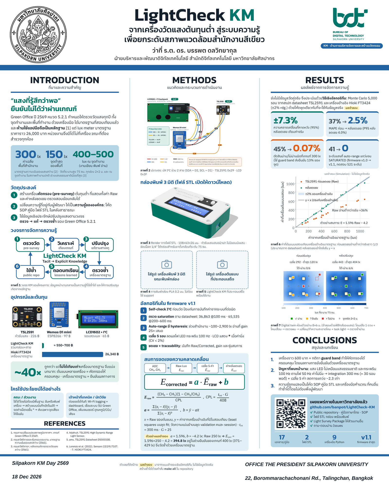

# Poster · Silpakorn KM Day 2569 (80 × 100 ซม.)



- `LightCheck-KM_poster_RGB.pdf` – ไฟล์เวกเตอร์ (RGB) สำหรับดูบนจอ / KM Portal
- ไฟล์ส่งพิมพ์ตามข้อกำหนด (PDF, CMYK, ≥ 100 ppi) สร้างด้วยขั้นตอนด้านล่าง

## สร้างใหม่

```bash
python poster/build_poster.py                # poster.html จากผลใน calibration/sim และ tools/survey
cd poster && npm i playwright && node render.js 2.0833 poster_200ppi.png   # PNG 200 ppi + RGB PDF
python to_cmyk.py poster_200ppi.png poster_CMYK_200ppi.pdf 200 <CMYK.icc>  # แปลงเป็น CMYK
```

ใช้ CMYK ICC profile ของโรงพิมพ์ (เช่น FOGRA39 / SWOP) เป็นอาร์กิวเมนต์สุดท้าย
ตัวเลขทั้งหมดในโปสเตอร์ดึงจาก `calibration/sim/montecarlo_summary.json` และ `tools/survey/office_twin_result.json`
ตัวเลขที่ติดป้าย "ผลจำลอง" มาจากแบบจำลองเชิงอัลกอริทึม ไม่ใช่ข้อมูลวัดจริง
